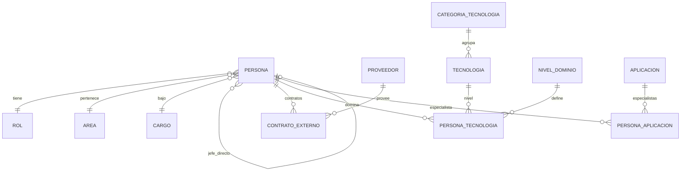
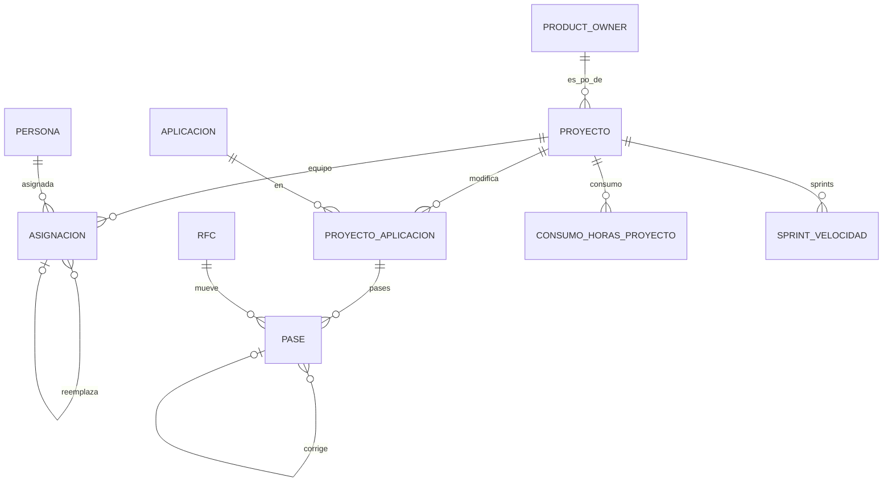
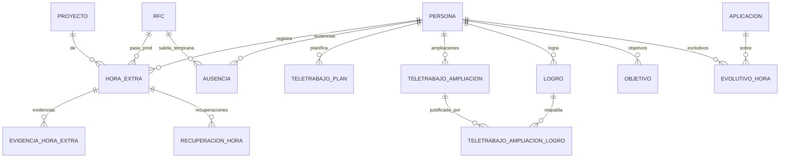

# MODELO DE DATOS — TeamHub Dev

Modelo relacional en **PostgreSQL 16+** derivado de `REQUISITOS.md` (versión 8). El archivo `schema.sql` es ejecutable y contiene tablas, restricciones, triggers, vistas y datos iniciales. Fue probado en PostgreSQL 16 con datos de ejemplo: se comprobó que las reglas de negocio rechazan lo que deben rechazar y que las vistas calculan los resultados esperados.

## 1. Decisiones de diseño

- **Esquema `teamhub`**, nombres en español y `snake_case`.
- **Estados como texto con `CHECK`**, no como enums de PostgreSQL: agregar un estado es una migración simple.
- **Reglas de negocio dentro de la base de datos** cuando son críticas (orden de pases, evidencia obligatoria, cupo de oficina, vacaciones). Así ninguna pantalla ni script puede saltárselas. Las demás las aplica la aplicación.
- **Parámetros en tabla** (`parametro_sistema`): 300 horas, 7 objetivos, 80% del ROM, 30 días, 2 semanas de vacaciones. Cambiar una regla no requiere tocar código.
- **RFC como entidad propia** relacionada con las aplicaciones mediante la tabla `pase`. Un RFC puede mover varias aplicaciones.
- **El ambiente del RFC se repite en `pase`** para poder usar una clave foránea compuesta. Esto garantiza a nivel de base de datos que un pase a TEST usa un RFC de TEST, y que una hora extra solo se vincula a un RFC de PROD (RN-15).
- **"Recuperado" y "no recuperable" son estados derivados**, no columnas: se calculan con `recuperacion_hora`, el saldo y la marca de atrasado del proyecto.
- **Las métricas DORA fase A son vistas** sobre `pase`: no hay que guardar nada adicional.
- **Proveedores de externos:** `proveedor` es un catálogo (Netby y Adalove vienen cargados). El proveedor y el **costo por hora** viven en cada fila de `contrato_externo`, no en la persona: así una renovación puede cambiar de proveedor o de costo sin perder el historial, y la base impide que los períodos de contrato de una misma persona se solapen.
- **Horas mensuales por asignación:** cada fila de `asignacion` tiene `horas_mensuales`. Si no se indican, se calculan con el parámetro `horas_mes_base` (160 horas al 100%): un desarrollador al 100% tiene 160 y un scrum al 50% tiene 80. Se registran para todos, pero solo los externos se facturan: pago mensual = horas mensuales × costo por hora del contrato vigente. Los internos no aparecen en la facturación.
- **Horas presupuestadas por asignación:** `horas_presupuestadas` guarda el total de horas de esa persona en el proyecto (por ejemplo 350). Se compara con las horas planificadas (meses × horas mensuales) para alertar cuando se exceden.
- **Mes completo:** a los proveedores siempre se les paga el mes completo. La facturación incluye cada mes en que la asignación tiene al menos un día, sin prorrateo.
- **Reemplazos:** una asignación puede apuntar a la que reemplaza (`reemplaza_asignacion_id`). Así queda el rastro de un interno que sale a otro proyecto y un externo que entra en su lugar; la facturación del externo empieza en el mes de su fecha de inicio y ese mes se paga completo.
- **Product Owner:** `product_owner` es un catálogo de contactos (nombres, correo, celular, cargo, área) y cada proyecto apunta a su PO. Un externo no se puede asignar a un proyecto sin PO, porque a él se envían las facturas.
- **Autenticación con Entra ID:** `persona.entra_object_id` enlaza al usuario; `persona.rol_app` define su rol en la aplicación.

## 2. Diagramas

### 2.1 Personas, catálogos y conocimientos

### 2.2 Proyectos, asignaciones y trazabilidad

### 2.3 Día a día, logros, objetivos y evolutivos

## 3. Tablas por módulo

| Módulo | Tablas | Contenido |
|---|---|---|
| Parámetros | `parametro_sistema`, `config_oficina` | Valores configurables y cupo por piso (3 y 8, 15 puestos cada uno) |
| Catálogos | `cargo`, `area`, `rol`, `proveedor`, `product_owner`, `categoria_tecnologia`, `tecnologia`, `nivel_dominio`, `aplicacion` | Listas editables. `aplicacion` guarda el proyecto y repositorio de Azure DevOps (clave para la fase B) |
| Personas | `persona`, `contrato_externo`, `persona_aplicacion`, `persona_tecnologia` | Datos de la persona, piso, jefe directo, historial de contratos de externos (con proveedor y costo), especialidades y niveles |
| Proyectos | `proyecto`, `asignacion`, `proyecto_aplicacion`, `consumo_horas_proyecto` | Presupuesto, ROM, PO, marca de atrasado, equipo con porcentaje, horas mensuales y reemplazos, aplicaciones con fecha de inicio de trabajo |
| Trazabilidad | `rfc`, `pase` | RFC de TEST y PROD; pases normales y correcciones en posproducción |
| Horas extra | `hora_extra`, `evidencia_hora_extra`, `recuperacion_hora` | Registro, evidencias, aprobación y recuperación |
| Ausencias | `ausencia` | Permisos, salidas tempranas, vacaciones y cumpleaños en una sola tabla con `tipo` |
| Teletrabajo | `teletrabajo_plan`, `teletrabajo_ampliacion`, `teletrabajo_ampliacion_logro` | Planificador diario, ampliaciones temporales y los logros que las justifican |
| Desarrollo | `logro`, `objetivo`, `evolutivo_hora` | Logros, 7 objetivos por persona y año, horas de evolutivos |
| Métricas | `indicador_metrica`, `sprint_velocidad` | Definición de cada indicador (objetivo, frecuencia, por qué se mide) y velocidad por sprint |
| Auditoría | `auditoria` | Registro de cambios y aprobaciones (lo llena la aplicación) |

## 4. Dónde se aplica cada regla

**BD** = restricción o trigger en la base de datos. **Vista** = la base calcula el resultado y la aplicación muestra la alerta. **App** = lógica de la aplicación.

| Regla | Dónde | Cómo |
|---|---|---|
| RN-01 Datos personales por rol | App | Autorización con `rol_app` y `jefe_directo_id` |
| RN-02 Cédula y correo únicos | BD | `UNIQUE` |
| RN-03 Contratos solo para externos, con proveedor y costo | BD | Trigger `trg_contrato_valida`; proveedor y costo obligatorios (`NOT NULL`, costo no negativo) |
| RN-04 Historial de renovaciones | BD + Vista | Una fila por contrato; `vw_contrato_vigente` |
| RN-05 Alerta de fin de contrato | Vista | `vw_alerta_contrato` (30/15/7 días, con proveedor) |
| RN-34 Proveedor y costo por contrato | BD | Tabla `proveedor`; columnas en `contrato_externo`; períodos sin solape |
| RN-35 Costo y facturación confidenciales | App | Solo el Jefe de Desarrollo ve `costo_hora`, `vw_externos_por_proveedor` y las vistas de facturación |
| RN-36 Consulta por proveedor | Vista | `vw_externos_por_proveedor` |
| RN-06 Riesgo de un solo experto | Vista | `vw_cobertura_tecnologia`, `vw_cobertura_aplicacion` |
| RN-07 Sobreasignación | Vista | `vw_sobreasignacion`, `vw_carga_actual` (alerta, no bloquea) |
| RN-08 Presupuesto vs ROM | Vista | `vw_proyecto_alertas` (80% del ROM y excedido) |
| RN-09 Consumo de horas | Vista + App | Planificadas vs presupuestadas: `vw_proyecto_horas_planificadas`. Reales: `consumo_horas_proyecto` (ver supuestos) |
| RN-42 Horas planificadas vs presupuestadas por asignación | Vista | `vw_asignacion_horas` (3 meses × 160 = 480 frente a 350) |
| RN-37 Pago mensual = horas × costo por hora, mes completo | BD + Vista | Trigger que calcula las horas mensuales (160 × dedicación); `vw_asignacion_mes`, `vw_facturacion_mensual`; los internos no se facturan |
| RN-38 Reemplazo de interno por externo | BD + Vista | `reemplaza_asignacion_id` con trigger (otra persona, mismo proyecto y rol); el mes de entrada se paga completo |
| RN-39 Externo solo con PO | BD | Triggers `trg_asignacion_valida` y `trg_proyecto_po_valida` |
| RN-40 Facturación mensual por proyecto | Vista | `vw_facturacion_resumen` (por mes, proyecto, PO y proveedor) |
| RN-41 Asignación de externo más allá del contrato | Vista | `vw_alerta_asignacion_externo` |
| RN-10 Por terminar | Vista | `vw_proyecto_alertas`, `vw_disponibles_pronto` |
| RN-11 Orden TEST → PROD | BD | Trigger `trg_pase_valida` (incluye correcciones) |
| RN-12 Formato y unicidad del RFC | BD | `CHECK` y `UNIQUE (numero, ambiente)` |
| RN-13 Varios pases, normal o corrección | BD | Columnas `tipo` y `pase_corregido_id` con `CHECK` |
| RN-14 Evidencia, actividad y tiempo | BD | `CHECK` y trigger `trg_hora_extra_aprobacion` |
| RN-15 Horas extra solo de pases a PROD | BD | FK compuesta `(rfc_id, rfc_ambiente)` con ambiente fijo en PROD |
| RN-16 No recuperar con proyecto atrasado | BD | Trigger `trg_recuperacion_valida` |
| RN-18 Saldo de horas extra | BD + Vista | El trigger impide recuperar más de lo aprobado; `vw_saldo_horas_extra` |
| RN-19 Aporte para teletrabajo | App | Sugerencia, no automática |
| RN-20 Cumpleaños | BD | Trigger (mismo día o lunes/viernes de esa semana) e índice único por año |
| RN-21 Solape de ausencias | App | Alerta sobre `ausencia` y `asignacion` |
| RN-22 Ampliación temporal | BD + App | `teletrabajo_ampliacion`; la aplicación vuelve a 2 días al terminar |
| RN-23 Cupo de oficina por piso | BD + Vista | Trigger `trg_teletrabajo_cupo`; `vw_cupo_oficina` |
| RN-24 Logro con descripción y evidencia | BD | `CHECK` |
| RN-25 Siete objetivos | BD + Vista | Número 1 a 7 único por persona y año; `vw_objetivos_persona` |
| RN-26 300 horas, se puede sobrepasar | Vista | `vw_progreso_evolutivos` (porcentaje puede superar 100) |
| RN-27 Atrasado manual | BD | Columnas con `CHECK` (fecha y motivo obligatorios) |
| RN-28 Corrección indica pase y motivo | BD | `CHECK` y trigger; vistas DORA |
| RN-29 Salida temprana por pase nocturno | BD + App | `rfc.es_nocturno` y `ausencia.rfc_id`; la sugerencia la hace la aplicación |
| RN-30 Máximo 2 semanas de vacaciones | BD | Trigger `trg_ausencia_valida` (usa el parámetro) |
| RN-31 Aprobación por jefe asignado | App | Según `jefe_directo_id` |
| RN-33 Una semana completa, no juntas | BD | `CHECK` (lunes a viernes) y trigger |

Además, la base impide que una persona tenga dos asignaciones solapadas en el mismo proyecto, y valida los porcentajes por rol (scrum 25/50/100, desarrollador 50/100, arquitecto 25 a 100).

## 5. Vistas

| Vista | Para qué sirve |
|---|---|
| `vw_alerta_contrato` | Externos con contrato por vencer (umbral 30/15/7), con su proveedor |
| `vw_externos_por_proveedor` | Personas activas, contratos por vencer y costo por hora mínimo, promedio y máximo por proveedor |
| `vw_asignacion_mes` | Cada asignación desglosada por mes (mes completo, sin prorrateo) |
| `vw_asignacion_horas` | Horas planificadas frente a las presupuestadas de cada asignación |
| `vw_facturacion_mensual`, `vw_facturacion_resumen` | Horas y monto estimado por externo (detalle) y por mes, proyecto, PO y proveedor (resumen para enviar las facturas) |
| `vw_proyecto_horas_planificadas` | Horas de las asignaciones (meses × horas mensuales) frente al presupuesto de horas del proyecto |
| `vw_alerta_asignacion_externo` | Externos cuya asignación termina después de su contrato o que no tienen contrato |
| `vw_proyecto_alertas` | Presupuesto al 80% del ROM, excedido, días para el fin, vencido sin cerrar |
| `vw_carga_actual`, `vw_sobreasignacion` | Dedicación actual y fechas con más del 100% |
| `vw_disponibles_pronto`, `vw_disponibles_ahora` | A quién se puede asignar en proyectos por iniciar |
| `vw_saldo_horas_extra` | Horas aprobadas, recuperadas y saldo por persona |
| `vw_vacaciones_anio` | Semanas tomadas y disponibles |
| `vw_cupo_oficina` | Ocupación por día y piso |
| `vw_objetivos_persona`, `vw_progreso_evolutivos` | Avance de objetivos y de las 300 horas |
| `vw_cobertura_tecnologia`, `vw_cobertura_aplicacion` | Dashboard de conocimientos y riesgos |
| `vw_dora_frecuencia` | Pases a PROD por mes, aplicación y proyecto |
| `vw_dora_tiempo_entrega` | Días de inicio a PROD y de TEST a PROD |
| `vw_dora_tasa_fallos` | % de pases normales que tuvieron corrección |
| `vw_dora_tiempo_restauracion` | Días entre el pase fallido y su corrección |

## 6. Supuestos a confirmar

1. **Horas reales por proyecto (RN-09):** los requisitos no dicen de dónde salen. Agregué `consumo_horas_proyecto` como carga manual mensual. Si prefieres otra fuente, se cambia esa tabla.
2. **"Experto" en conocimientos (RN-06):** lo definí como el nivel de dominio más alto del catálogo (Avanzado). Hay riesgo cuando hay uno o ninguno.
3. **"No juntas" en vacaciones (RN-33):** lo interpreté como que las dos semanas no pueden ser consecutivas ni estar a menos de 7 días una de otra.
4. **Año de las vacaciones:** se cuenta por año calendario, según la fecha de inicio de la semana (pendiente de confirmar en los requisitos).
5. **Formato del RFC:** `RFC-` seguido de dígitos, sin límite de cantidad.
6. **Fecha de cumpleaños:** se guarda como fecha completa, pero solo se usan mes y día. El 29 de febrero cuenta como 28 en años no bisiestos.
7. **Costo de externos (RN-34, RN-37):** entendí que se paga por hora, con las horas mensuales de la asignación. El costo vive en el contrato, así que puede ser distinto por proveedor, persona o rol.
8. **Horas mensuales (RN-37):** un mes tiene 160 horas laborables (valor fijo configurable en `horas_mes_base`; no varía según los días laborables de cada mes). Las 350 horas del ejemplo son el total del desarrollador en el proyecto, no la cantidad mensual.
9. **Mes completo (RN-37, RN-38):** se factura todo mes en el que la asignación tiene al menos un día, incluido el de entrada y el de salida, sin prorrateo.
10. **Contrato en la facturación:** se usa el contrato vigente al inicio de cada tramo del mes. Si un contrato cambia de costo en la mitad de un mes, ese mes usa el costo del primer contrato.
11. **Visibilidad del costo (RN-35):** supuse que solo lo ve el Jefe de Desarrollo.
12. **Product Owner:** lo modelé como un contacto, no como usuario de la aplicación ni como parte del equipo. Si debe iniciar sesión, se le agrega un vínculo a `persona`.
13. **Roles de la aplicación:** tres valores (`jefe_desarrollo`, `jefe_area`, `miembro`) en `persona.rol_app`. Si prefieres manejarlos con grupos de Entra ID, esa columna se reemplaza.

## 7. Lo que no está en la base de datos

- El **límite semanal de teletrabajo** (2 días, o 3 con ampliación) lo calcula la aplicación con `teletrabajo_plan` y `teletrabajo_ampliacion`. Solo el cupo de oficina por piso está en la base.
- Las **sugerencias** (ampliar teletrabajo, registrar salida temprana por pase nocturno) son de la aplicación.
- La **emisión de facturas** no está: las vistas de facturación calculan horas y montos estimados por mes para que envíes las facturas al PO, pero no generan documentos ni registran si una factura fue enviada o pagada.
- La **auditoría** (`auditoria`) la llena la aplicación al guardar cambios.

## 8. Cómo usarlo con EF Core y un agente de código

- Entrega `schema.sql` y este documento al agente de código junto con `REQUISITOS.md` y `DESIGN.md`/diseño.
- Dos caminos válidos: partir del esquema (generar las entidades a partir de la base) o programar las entidades primero. En ambos, los **triggers, la restricción de exclusión y el índice parcial** no se generan solos: se agregan en las migraciones con `migrationBuilder.Sql(...)`.
- La extensión `btree_gist` (para evitar asignaciones solapadas) necesita permisos para crearse. En Amazon RDS la crea un usuario con el rol `rds_superuser`.
- Construye por módulos en el orden de `REQUISITOS.md`, y escribe pruebas para cada regla de la sección 4 que esté en la base: ya hay un modelo de cómo probarlas (insertar el caso inválido y esperar el rechazo).
